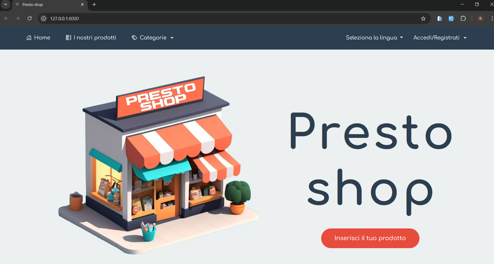

# Presto Shop

Web app di annunci di compravendita, realizzata in team come progetto finale del corso **Aulab Hackademy**.

Gli utenti pubblicano prodotti con foto, un revisore li approva o li rifiuta, e Google Cloud Vision analizza le immagini caricate. Interfaccia in 6 lingue.

**Stack:** Laravel 11 · Livewire 3 · Bootstrap 5 · MySQL · Google Cloud Vision



## Requisiti

PHP 8.2+, Composer, Node.js 18+, MySQL in esecuzione.

## Avvio

**1.** Installa e configura tutto con un solo comando (crea anche il database):

```bash
composer setup
```

Il progetto si collega a MySQL con utente `root` e password `root`. Se il tuo MySQL usa credenziali diverse, il comando si ferma con `Access denied`: correggi `DB_USERNAME` e `DB_PASSWORD` nel file `.env` appena creato e rilancialo.

> La password è quella scelta durante l'installazione di MySQL. Con XAMPP di solito è vuota: in quel caso scrivi `DB_PASSWORD=` senza niente dopo l'uguale.

**2.** Avvia il server:

```bash
php artisan serve
```

Il sito è su **http://localhost:8000**.

## Extra (facoltativi)

- **Diventare revisore:** registrati dal sito, poi esegui `php artisan app:make-user-revisor tua@email.it`
- **Google Cloud Vision:** metti la chiave del tuo service account in `google_credential.json` nella root del progetto (non committarla!) e avvia `php artisan queue:work` per oscurare i volti e analizzare le immagini. Senza questo file il sito funziona normalmente, ma l'analisi delle immagini viene saltata.
